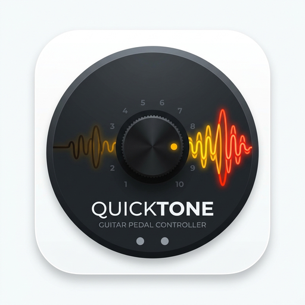
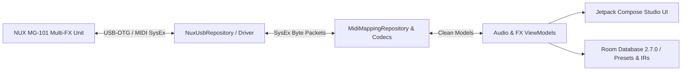

# QuickTone Guitar Lab (NUX MG-101) 🎸🎛️

<p align="center">
  
</p>

<p align="center">
  <b>Professional Real-Time Hardware Controller, USB-OTG/BLE Patch Editor & IR Cabinet Loader for NUX MG-101</b>
</p>

<p align="center">
  
  
  
  
  
</p>

---

## 🌟 Overview

**QuickTone Guitar Lab** is an advanced guitar tone workstation and hardware controller engineered specifically for the **NUX MG-101 Multi-Effects Modeling Processor**. By interfacing directly via **USB-OTG Host** and **Bluetooth Low Energy (BLE)**, guitarists can edit their entire signal chain with sub-millisecond responsiveness on their mobile device or tablet.

Tweak high-gain amplifier models, dial in analog compressor pedals, sculpt parametric EQs, load 3rd-party impulse response (IR) speaker cabinets, and back up unlimited tone presets to a local offline database or cloud tone exchange.

---

---

## 📱 App Screenshots

<p align="center">
  <table>
    <tr>
      <td align="center" width="25%">
        <br />
        <b>1. Main Screen</b>
      </td>
      <td align="center" width="25%">
        <br />
        <b>2. Core Experience</b>
      </td>
      <td align="center" width="25%">
        <br />
        <b>3. Interactive Mode</b>
      </td>
      <td align="center" width="25%">
        <br />
        <b>4. Advanced Features</b>
      </td>
    </tr>
    <tr>
      <td align="center" width="25%">
        <br />
        <b>5. Workflow / Details</b>
      </td>
      <td align="center" width="25%">
        <br />
        <b>6. Studio Console</b>
      </td>
      <td align="center" width="25%">
        <br />
        <b>7. Settings & Config</b>
      </td>
      <td align="center" width="25%">
        <br />
        <b>8. Dark & Light Theme</b>
      </td>
    </tr>
  </table>
</p>

---

## ✨ Key Features

- 🎛️ **Live FX Signal Chain Routing**:
  - Interactive drag-and-order signal path: `WAH -> COMP -> EFX -> AMP -> EQ -> NR -> MOD -> DLY -> RVB`.
  - Visual bypass toggles, real-time gain/level meters, and stereo pan adjustments.
- 🔌 **Bi-Directional USB-OTG & MIDI SysEx Protocol**:
  - Zero-latency bidirectional communication using custom binary SysEx protocol parsing.
  - Automatic hardware handshake, state synchronization, and connection recovery.
- 🔊 **Impulse Response (IR) Cabinet Manager**:
  - Load 24-bit/48kHz `.wav` impulse responses directly into user slots.
  - Interactive microphone placement (axis position and distance simulator).
- ☁️ **Preset Cloud & Library Manager**:
  - Save, organize, and export preset bundles (`.mg101p`).
  - Search community presets tagged by artist, genre, or song.
- 🎯 **High-Precision Chromatic Tuner**:
  - Fast-response analog needle simulation and strobe display.
  - Support for drop tunings, open tunings, and A4 frequency calibration (435Hz - 445Hz).

---

## 🏗️ Hardware Architecture & Tech Stack



### Technical Stack:
| Layer | Technologies |
|---|---|
| **Language & Runtimes** | Kotlin 2.2.10, Coroutines, StateFlow |
| **UI Framework** | Jetpack Compose (Material 3 Dark Studio Aesthetic) |
| **Hardware I/O** | Android USB Host API (`UsbManager`, `UsbDeviceConnection`), MIDI SysEx |
| **Local Storage** | Room Database 2.7.0, KSP CodeGen, Moshi JSON Serialization |
| **Networking** | Retrofit 2.12.0, OkHttp 4.10.0 (Cloud Presets Sync) |

---

## 📂 Project Structure

```text
nux-mg-101-quick-tone/
├── app/
│   ├── src/main/java/com/creativeblisslabs/nuxmg101/
│   │   ├── ui/
│   │   │   ├── screens/         # Tuner, EffectEdit, HardwareControls, CloudPresets
│   │   │   ├── components/      # UsbManagerDialog, TunerNeedleView, StudioKnob
│   │   │   └── theme/           # Studio dark neon color palettes
│   │   └── data/
│   │       ├── repository/      # NuxUsbRepository, MidiMappingRepository
│   │       ├── model/           # SysEx payloads, AmpModels, Patch models
│   │       └── db/              # Room AppDatabase, PatchDao, IRDao
│   └── src/main/res/            # Vectors, drawables, XML layouts
├── playstore/                   # App icon 512x512, feature graphics
└── assets/                      # Stock IRs, default factory presets
```

---

## 🚀 Building & Running

### Requirements
- Android Studio Ladybug+
- Android Device with USB-OTG support running Android 8.0+ (API 26+)
- USB-C OTG cable connected to NUX MG-101

### Commands
```bash
# Build Android APK
./gradlew :app:assembleDebug

# Run Unit Tests
./gradlew test
```

---


---
## 📄 License
Designed and developed by **CreativeBliss Labs**. All rights reserved.
